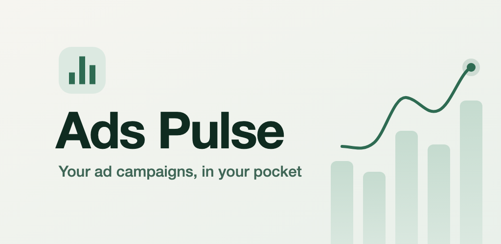
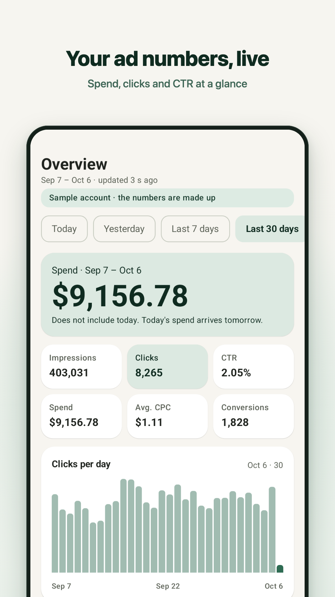
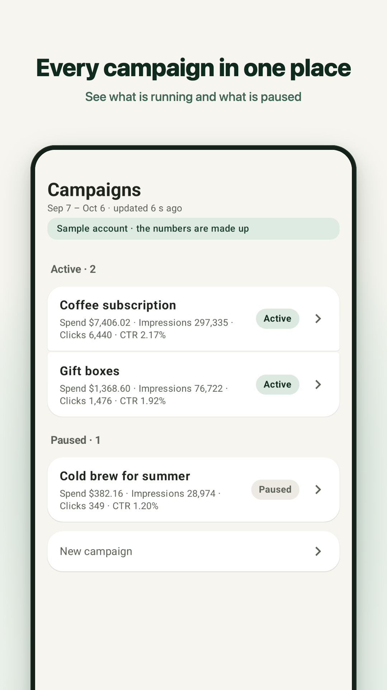
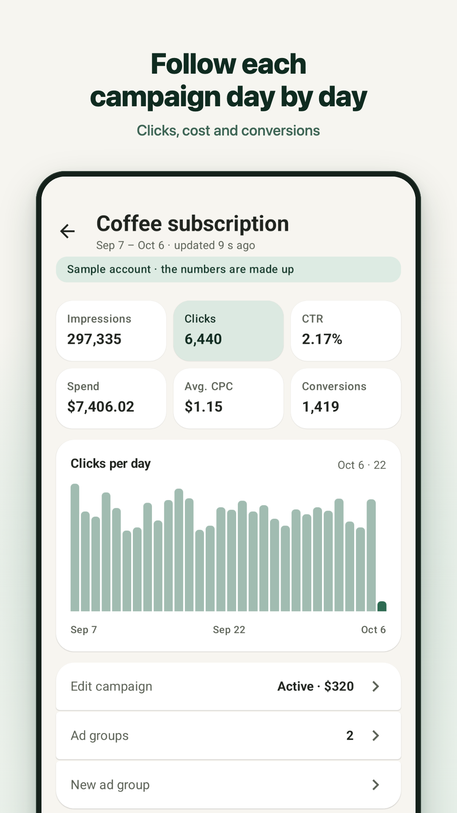
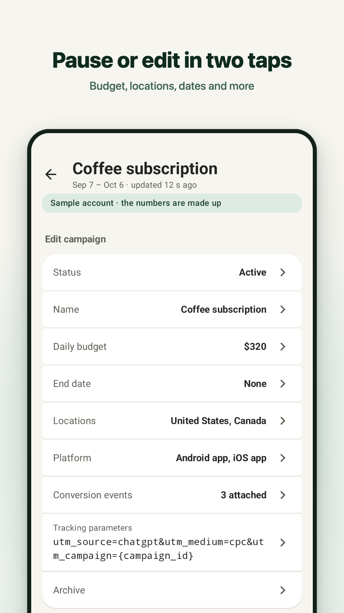
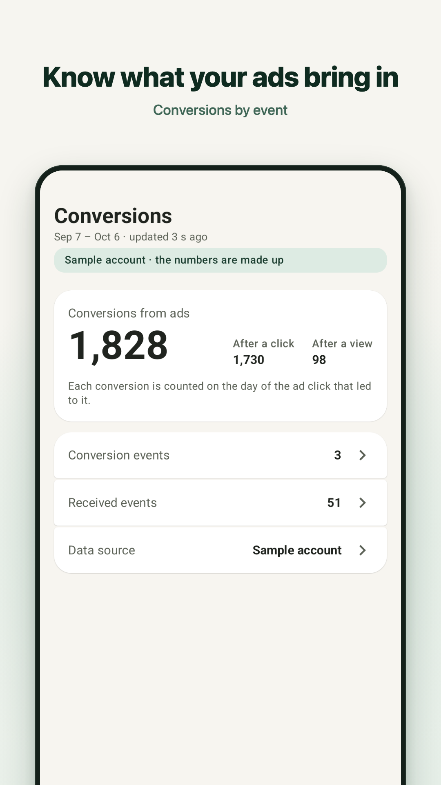
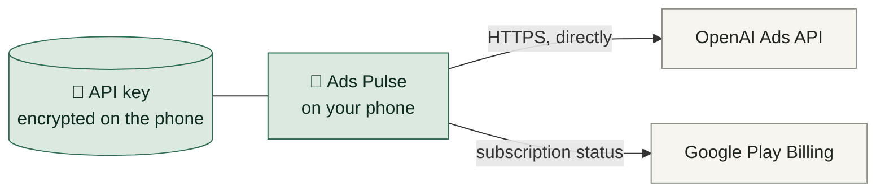

# Ads Pulse

**Your ChatGPT Ads account, in your pocket.**

Live numbers, charts and alerts for every campaign, ad group and ad, and the controls to change them, on Android.

 

 

 

  

  
  
  
  
  

---

## ✨ What it does

<table>
  <tr>
    <td width="50%" valign="top">
      <h3>📊 Live numbers</h3>
      Impressions, clicks, spend, CTR, cost per click, CPM and conversions for today, yesterday, the last 7 or 30 days, this month or any dates you pick.
    </td>
    <td width="50%" valign="top">
      <h3>📈 Charts that follow the trend</h3>
      Per hour for a single day, per day for longer ranges, on the account and on every campaign.
    </td>
  </tr>
  <tr>
    <td valign="top">
      <h3>🔎 Drill down</h3>
      From the account to each campaign, ad group and ad, with the same date range everywhere.
    </td>
    <td valign="top">
      <h3>✏️ Manage on the go</h3>
      Pause and resume, rename, change daily budgets, bids, locations, platforms, end dates, ad text, links and tracking.
    </td>
  </tr>
  <tr>
    <td valign="top">
      <h3>➕ Create</h3>
      New campaigns, ad groups and ads: one picture (choose the square part shown) or 4 to 6 pictures. Everything new starts paused.
    </td>
    <td valign="top">
      <h3>🩺 Campaign check</h3>
      Delivery problems, and every change shown beside the numbers before and after it.
    </td>
  </tr>
  <tr>
    <td valign="top">
      <h3>🎯 Conversions</h3>
      Attributed conversions per event, per day, per ad group and per ad, the events OpenAI received, and your data source. Delivery per country, device, platform and product.
    </td>
    <td valign="top">
      <h3>🔔 Alerts</h3>
      A notification when new clicks or new conversions arrive, checked in the background.
    </td>
  </tr>
  <tr>
    <td valign="top">
      <h3>👥 Audiences and product feeds</h3>
      Manage audiences (people from a list or a file), product feeds (titles, prices, stock), hotel feeds and the conversion setup from the phone.
    </td>
    <td valign="top">
      <h3>🕓 Change history</h3>
      Every change made to the account, in order.
    </td>
  </tr>
  <tr>
    <td valign="top">
      <h3>🔐 App lock</h3>
      Fingerprint, face or screen lock. The lock screen shows no account data.
    </td>
    <td valign="top">
      <h3>🌗 Light and dark</h3>
      Follows the phone, or pick light or dark yourself.
    </td>
  </tr>
</table>

> **Nothing changes without you.** Every change is shown first and is sent only after you confirm it.

## 🧪 Try it without an account

Tap **Try with a sample account** on the first screen and walk through every screen with made-up numbers. Nothing is sent to OpenAI in this mode.

## 🔌 Connect your account

1. Open **Ads Manager** on the web and go to **Settings › General**. **API keys** is at the bottom of the page.
2. Create an API key and copy it.
3. Paste it into Ads Pulse.

## 🛡️ Your data stays with you

- **No server of its own.** The app talks straight from your phone to OpenAI's Ads API.
- **Your API key** is stored encrypted on your phone only and is never sent to the developer.
- **No ads, no data sales.** Anonymous usage and crash reports can be switched off under **Settings › Privacy**.

Read the full [Privacy policy](https://sites.google.com/view/ads-pulse-privacy-policy/).

## 🌍 Ten languages

English · עברית · Español · Français · Deutsch · Italiano · Português · 日本語 · 한국어 · العربية

Pick the language inside the app, with right-to-left layouts for Hebrew and Arabic.

## 💳 Price

Free to download and free to try with the sample account. Connecting your own ad account is a subscription, paid by the month or by the year through Google Play, and can be cancelled at any time.

---

## 🛠️ Built with

| | |
|---|---|
| **Language** | Kotlin 2.4 |
| **UI** | Jetpack Compose, Material 3 |
| **Background work** | Kotlin Coroutines, WorkManager |
| **Security** | AndroidX Biometric, encrypted key storage |
| **Payments** | Google Play Billing |
| **Analytics** | Firebase Analytics and Crashlytics, optional |
| **Build** | Android Gradle Plugin 9.4, Gradle 9.7 |
| **Android** | minSdk 28 (Android 9), targetSdk 36 |

---

**Ads Pulse** is made by an independent developer, Eran Gross. 
It is not an OpenAI product and is not affiliated with, endorsed by or sponsored by OpenAI. 
ChatGPT is a trademark of OpenAI.

[Privacy policy](https://sites.google.com/view/ads-pulse-privacy-policy/) · © 2026 Eran Gross · All rights reserved, see [LICENSE](LICENSE)

